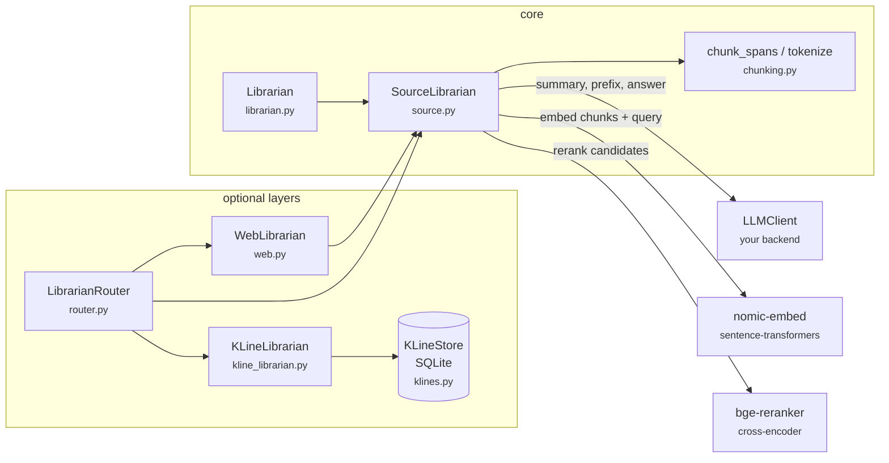
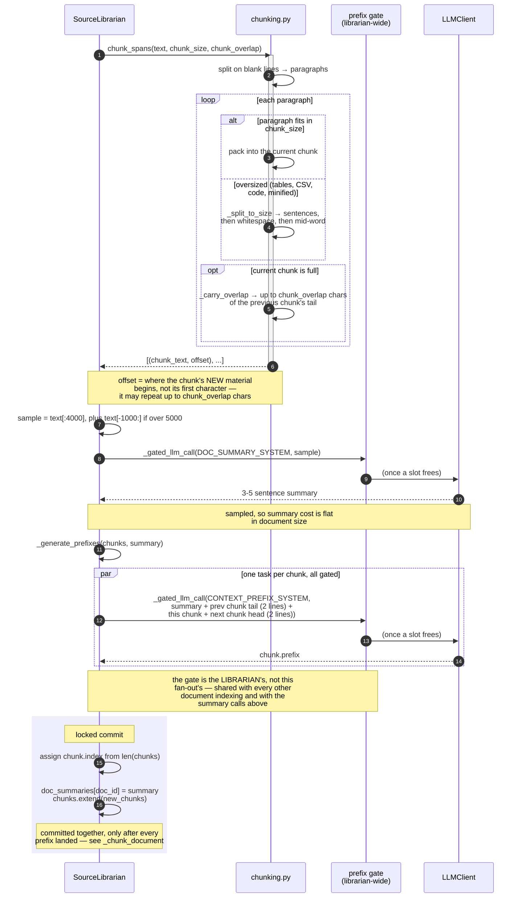
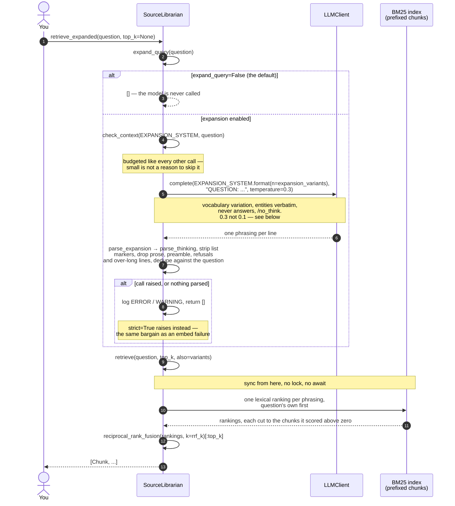
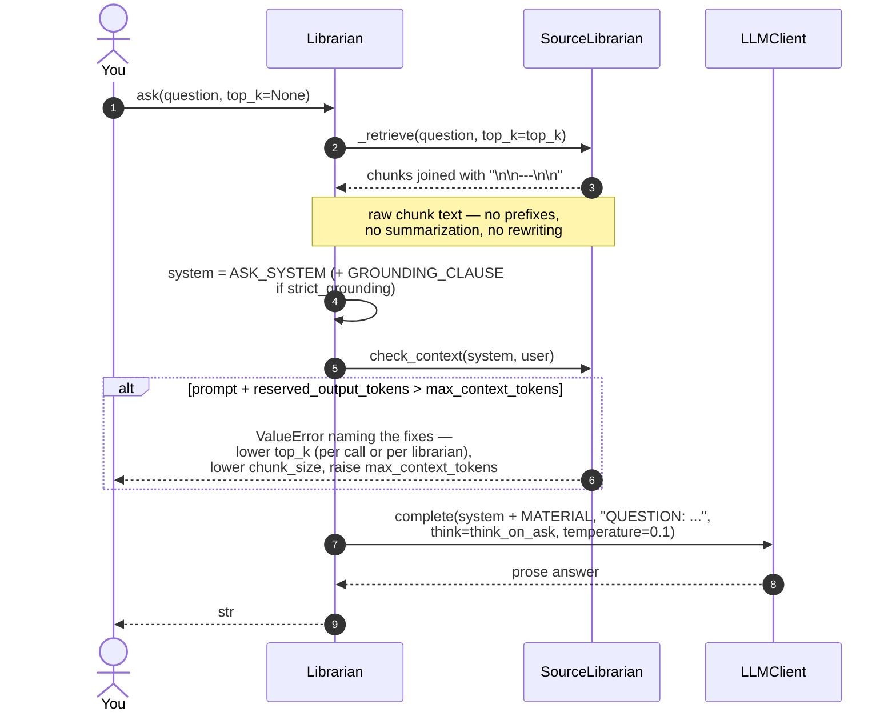
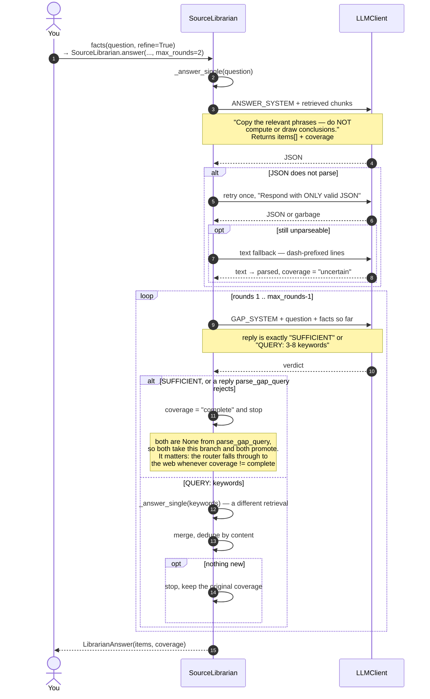
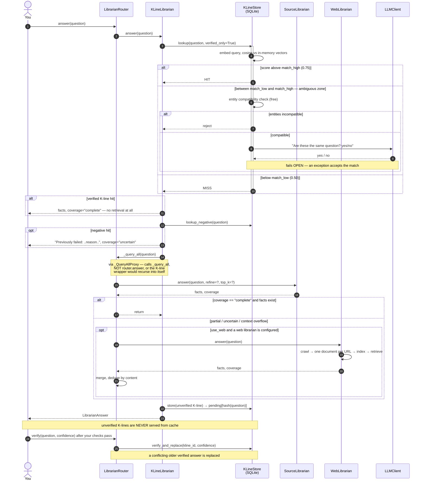

# How librarium works

Sequence diagrams for the paths that matter, with pointers into the
source. Read this if you want to know what happens between `index()` and
an answer — or if you are about to change any of it.

Nothing here is required to *use* librarium; the [README](../README.md)
covers that. The numbers quoted below are the **defaults** — chunk
geometry, `top_k`, the context budget and the model names are all
constructor arguments (see Configuration in the README), so a tuned librarian will differ.

**Pointers into the source are names, not line numbers.** They used to be
line numbers, and every one of them had drifted — `check_context` was cited
at a line 1100 short of where it lives. A name a reader can grep survives an
edit above it; a number silently starts pointing at something else, which is
why this file cites names rather than line numbers: its whole job is
pointing.

**Contents**

- [The shape of it](#the-shape-of-it)
- [Indexing a document](#indexing-a-document)
- [Chunking a large document](#chunking-a-large-document)
- [`retrieve()` — the dual index](#retrieve--the-dual-index)
- [`retrieve_expanded()` — query expansion](#retrieve_expanded--query-expansion)
- [`ask()` — one call, raw chunks](#ask--one-call-raw-chunks)
- [`facts(refine=True)` — gap-finding](#factsrefinetrue--gap-finding)
- [The router and the K-line cache](#the-router-and-the-k-line-cache)
- [Where the LLM is used](#where-the-llm-is-used)
- [Where the failure paths lead](#where-the-failure-paths-lead)

## The shape of it

Two classes do the work. `Librarian` (`src/librarium/librarian.py`) is a
thin facade over `SourceLibrarian` (`src/librarium/source.py`), which
holds the documents, the chunks, both indexes, and the prompts.
`LibrarianRouter` and `KLineStore` sit above that and are optional.



The important structural fact: **`WebLibrarian` is a `SourceLibrarian`
with a crawler in front of it.** Fetched pages are indexed one document
per URL and go through the identical retrieval pipeline, so provenance
comes back as the page URL. It builds that librarian **per question** —
each crawl indexes different pages — which is why `LibrarianRouter`'s
`source_librarian=` injection has no counterpart on `WebLibrarian.answer()`,
a decision argued at the construction site in `web.py` rather than an
omission.

## Indexing a document

`index()` replaces the index; `add_document()` adds to it. `_add_document`
runs in **three phases**, and the shape is the whole
point: the LLM work in the middle holds **no lock**, so a corpus handed
to `asyncio.gather` indexes its documents genuinely concurrently. Every
mutation happens inside one of the two locked phases, and nothing awaits
while the lock is held.

```mermaid
sequenceDiagram
    autonumber
    actor You
    participant L as Librarian
    participant S as SourceLibrarian
    participant FS as cache dir
    participant LLM as LLMClient

    You->>L: index(text, doc_id, cache=dir)
    L->>S: index(...)

    opt cache= was passed
        S->>FS: read index.json
        FS-->>S: format, content_hash, chunks, ...
        Note over S,FS: content_hash covers chunk_size,<br/>chunk_overlap, chunk_threshold,<br/>embed_model, EMBED_SOURCE and the<br/>format version. NOT the weights — no<br/>model is loaded here; that check waits<br/>for one
        alt hash matches this text
            S->>FS: load embeddings.npy + embed_fingerprint
            S->>S: rebuild BM25 from prefixed chunks
            S-->>L: done — zero LLM calls
        end
    end

    rect rgb(238, 238, 252)
        Note over S: PHASE 1 — locked, no awaits
        S->>S: claim doc_id, documents[doc_id] = text
        alt corpus ≤ chunk_threshold AND nobody mid-chunk
            S->>S: use_chunking = False<br/>drop chunks, summaries, indexes
            Note over S: whole text goes to the model at query<br/>time — no index-time LLM calls at all
        else above the threshold
            S->>S: pending = documents with no summary<br/>and not already claimed
            S->>S: _chunking.update(pending)
        end
    end

    rect rgb(252, 246, 230)
        Note over S,LLM: PHASE 2 — NO lock held.<br/>Other documents run here concurrently.
        loop each claimed document
            S->>S: _chunk_document(doc_id)
            Note over S: see the next diagram
        end
    end

    rect rgb(238, 238, 252)
        Note over S: PHASE 3 — locked, no awaits
        S->>S: use_chunking = True
        S->>S: _build_bm25() over prefixed chunks
        S->>S: _refresh_embeddings() over prefixed chunks
        S->>S: _load_reranker()
    end

    opt anything above raised
        S->>S: _roll_back(doc_id) under the lock
        Note over S: then release the claim — after the<br/>rollback, so another call cannot sweep<br/>up a document mid-undo
    end

    opt cache= was passed
        S->>FS: save() → index.json + embeddings.npy
    end
    L-->>You: return
```

The claim set (`self._chunking`) is what makes the concurrency correct.
Overlapping calls read the same `documents`, so without it every call in
a `gather` would sweep up every un-summarized document and chunk it
several times over (`_add_document`, where the claim is taken and given
back).

Two things worth knowing about the threshold:

- It applies to the **combined** corpus, not the individual document, so
  adding a document that pushes the total past `chunk_threshold` flips the
  librarian into chunked mode and retroactively chunks everything with no
  summary yet.
- The whole-document branch is **skipped while another call is mid-chunk**
  (`_add_document`'s `self._chunking` test). Dropping the chunks under a
  document about to commit
  more of them would leave a hole in the numbering. A corpus that is under
  the threshold only because a concurrent rollback shrank it gets chunked
  instead — costs calls, never wrong.

Consequences of the lock-free middle phase, both deliberate:

- `retrieve()` is synchronous and takes no lock, so a query issued *while*
  a document is indexing reads whatever is there. It degrades to whole
  documents rather than failing (`retrieve`, via `_whole_documents`).
- Chunk `index` is assigned at commit time, not when the chunks are built
  (`_chunk_document`'s locked commit). A `start = len(self.chunks)` read
  before the awaits
  would be a promise about where chunks will land, made before another
  document has had its chance to land theirs — two overlapping documents
  would both number from the same start.
- `save()` and `load()` are synchronous too, and unlike a query they act
  on the whole index, so they cannot simply read what is there. They
  observe the indexing instead of waiting for it — both halves of the
  replace guard, the adds (`_adds_in_flight_here`) and an `index()`
  holding it (`_replacing_elsewhere`, which compares
  `asyncio.current_task()` against the owner `_replacing()` records,
  because a bare `locked()` test would refuse `index()`'s own
  `_load_if_current`). `load()` raises `IndexBusyError` against either —
  its reset would strand the in-flight document's chunks under a `doc_id`
  the loaded index does not hold, which nothing later re-derives away.
  `save()` splits: mid-add it warns and writes, raising only under
  `strict`, because that partial file is recoverable (the missing
  document keeps no summary, so the next add re-chunks it); mid-`index()`
  it raises regardless, because the file records the incoming document
  with no chunks at all and `_load_if_current` accepts it as current.
  `index(..., cache=...)` does both from inside `_replacing()`, as its
  owner, and never trips either.
- Both observers go through `_observe_replace_guard()`, which asks
  whether the guard's loop is **alive** (`is_closed()`) rather than
  whether it is the caller's. Identity alone conflated two cases:
  ignoring state stranded by a finished `asyncio.run()` — right, or every
  later `load()` refuses forever — and ignoring an add running on another
  thread's loop, which reproduced the full orphan-chunk corruption
  through `asyncio.to_thread(lib.load, path)`. An open but idle loop
  counts as alive, because the task parked on it resumes and commits.
  `current_task()` is asked only when the guard's loop is the caller's
  running one: elsewhere it raises `RuntimeError` or answers about the
  wrong loop's task.

The BM25 index is never persisted — it is rebuilt from the prefixed chunks
on load. Cheap, and it avoids carrying a third-party object across
versions (`_build_bm25`).

**The embeddings are persisted, and so is the identity of the weights
that made them.** `save()` writes a `embed_fingerprint` key — the model's
own embedding of one fixed probe string, `EMBED_PROBE`, rounded — beside
`embeddings.npy`. It is deliberately *not* part of `content_hash()`:
`_load_if_current` runs the hash before any model has loaded, so a weight
identity there would mean loading the model at cache-check time or asking
the network. The comparison happens where the model actually loads
instead, the same shape `_check_code_revision` uses for the executed
remote code — record what was verified, compare when the thing loads,
respond on drift.

The identity is *behavioural* rather than provenance. The alternative was
the resolved Hub snapshot, which is exact and free, but the default
model's remote code fetches its weights with no revision at all
(measured — see `EMBED_REVISION`), so the snapshot obtainable from the HF
cache describes the config and stays put across exactly the upstream
weight change this is for. A probe answers the question actually being
asked — are the stored vectors comparable to the ones a query will
produce now? — and works for a local directory or any object with
`encode`.

Comparison is a **cosine distance against a tolerance** (1e-4), not an
equality check on a digest: with 768 components, a digest of the rounded
vector turns every rounding boundary into a cliff, and float noise on a
different device would trip one of them essentially always. Cosine is the
forgiving direction — a per-component relative error of *d* moves it by
only ~*d²*/2 — so fp32 across cpu/mps/cuda lands around 1e-10 and even
fp16 around 5e-5, while a genuine weight change lands orders of magnitude
further out. The residuals are stated where the constant is defined: one
probe is one point of the function, and a big enough dtype change reads
as drift.

On drift the vectors are **discarded** and retrieval degrades to
BM25-only. `_check_code_revision` only warns because nothing the remote
code produced is stored; here the stored artefact is the problem, and a
cosine between two embedding spaces is not a weak signal but a
meaningless number that still sorts. `load()`'s chunk-count and
`embed_model`-name mismatches already discard for the same reason.
Unlike the name mismatch it leaves `_dense_ok` alone — the model is fine,
only the vectors are not — so the next `add_document` re-embeds under the
loaded weights. Nothing on the *load* path re-embeds.

**`embed_source` is the fourth of that family and the newest**, and it
answers about the *text* rather than the weights: `save()` records which
text the vectors are of, and `load()` discards them when it is not the text
this librarium embeds. It has to be its own key because no other check on
that path can see it — `content_hash` covers `EMBED_SOURCE` but only
`_load_if_current` consults a hash, and the fingerprint compares the model,
which for this mismatch is *identical*. A **missing** key counts as a
mismatch rather than an unknown, because every file written before the
encoder was given the prefix holds vectors of `c.text`. It leaves
`_dense_ok` alone for the fingerprint's reason: honest vectors of the wrong
text, so the next `add_document` re-embeds all of them.

An index written before this existed carries no fingerprint. That is the
ordinary state on upgrade, so it is noted once at INFO and never warned
about, and nothing stamps the current model's identity onto vectors it
did not produce — that would launder "unverified" into "verified".

**A missing fingerprint has a second cause, and it needs a different
sentence.** `embed_fingerprint` returns `None` — recording no identity,
so the whole check is inert — whenever the probe comes back degenerate:
not a single vector, non-finite, or all zeros. That is now a WARNING at
the point the probe is taken, once per model object (`_current_fingerprint`
memoises on the object, so it cannot repeat per document or per query).
WARNING rather than INFO because the library installs no handler, and
under Python's last-resort handler an INFO is invisible to anyone who has
not configured logging — reporting an absent protection below the default
threshold is the silence being fixed. The `encode`-raises case stays
silent: the real work is about to fail loudly and a complaint from here
would arrive first and bury it.

`load()` then has to tell the two causes apart, because the remedies are
opposites — re-index, or stop expecting the check to work.
`_model_declined_probe()` is the discriminator, and it deliberately does
not probe: it reports only what this librarian's model has *already*
answered (`_reset` keeps the model's fingerprint across a `load()`, which
is what makes that possible), so `load()` pays no encode it did not pay
before. A librarian with no model loaded lands in the "predates the
feature" branch, correctly — it cannot yet know, and the probe will warn
when something first loads the model.

The assumption underneath — a real encoder never answers a non-empty
probe degenerately — is measured rather than asserted: an internal
benchmark run loaded the default model exactly as
`_ensure_embed_model` does and recorded the numbers (2026-08-09: 768 dims,
probe norm 20.5, no non-finite components, and librarium silent). It is
not in the suite, which is offline and model-free — and whose embedder
doubles are themselves degenerate probes, which is precisely why the
suite cannot answer this.
`INDEX_FORMAT_VERSION` is **not** bumped for the new key: it is optional
by construction, an older reader ignores it and a newer one reads its
absence as "not recorded", where a bump would force a full re-index —
one LLM call per chunk — on every index on disk.

## Chunking a large document

This is where the index-time LLM cost lives: **one summary call per
document, plus one prefix call per chunk.**



Design notes on this path:

- **The gate is librarian-wide and covers summary calls too**
  (`_gated_llm_call`). Both matter now that documents
  index concurrently: a per-fan-out semaphore would hand each document a
  fresh allowance, and a summary that skipped the gate meant one extra
  request per concurrent document on top of the cap.
- **Every chunk is ≤ `chunk_size`, including its carried overlap.**
  `_carry_overlap` computes the room left after the new material and
  shortens or skips the overlap to fit (`chunking.py:200`).
- **`_hard_split` refuses a break point in the first half** of the window
  (`cut < size // 2 → cut = size`, `chunking.py:250`) — a break at 20%
  wastes more capacity than the clean boundary buys.
- **The prefix window is what survives a chunk boundary.** Giving each
  prefix call the doc summary plus two lines either side is what lets it
  resolve pronouns and dangling references that the split severed.
- **The prefix goes to both retrieval halves, and to neither prompt.** BM25
  indexes `c.prefixed` and so does the encoder, so the per-chunk LLM call
  that wrote the prefix pays for both; `ask()` still sends `c.text`. It is a
  retrieval aid that never reaches the answering prompt. The encoder used to
  get `c.text` on the argument that a prefix would pollute the vectors —
  which was never measured and did not survive being measured; see
  `EMBED_SOURCE` in `source.py` for the runs.
- **Summary and chunks commit together** (`_chunk_document`). A summary
  recorded before the prefix calls would survive a failure among them, and
  the document would sit in `documents` with a summary and zero chunks —
  invisible to the pending sweep, which finds work by looking for the
  **absence** of a summary, so it would never be re-chunked.
- **Sibling prefix calls are cancelled on failure** (`_chunk_document`, the
  `except BaseException` around its `gather`).
  `gather` re-raises the first exception but leaves the rest running — and
  now that the gate is shared, abandoned work does not merely add a second
  allowance, it steals slots from the documents still queueing for the
  only one there is.

## `retrieve()` — the dual index

**No LLM call. Synchronous and lock-free**, so it never waits on an index
that is still being built. That is unchanged by query expansion:
`retrieve()` accepts extra phrasings through `also=`, but it never
*produces* them — the one call that does lives in the separate
`expand_query()` coroutine below.

```mermaid
sequenceDiagram
    autonumber
    actor You
    participant S as SourceLibrarian
    participant B as BM25 index<br/>(prefixed chunks)
    participant E as nomic-embed
    participant X as bge-reranker

    You->>S: retrieve(question, top_k=None, also=())
    S->>S: top_k = _resolve_top_k(top_k)<br/>(the librarian's own when not given)
    S->>S: variants = distinct_variants(question, also)<br/>drop empty / repeated / == question

    alt not use_chunking / no BM25 index / no chunks
        S-->>You: _whole_documents() — one chunk per document
    end

    alt embeddings present, length-aligned, and the model loads
        S->>E: encode("search_query: " + question)
        Note over S,E: the QUESTION only — variants stay<br/>lexical, see below
        E-->>S: query vector
        S->>S: cosine vs the whole chunk matrix<br/>(one np.dot, brute force) → cos_ranked
    else missing, broken, or count mismatch
        Note over S,E: retrieval_mode reports which path you<br/>got. strict=True raises instead.
        E-->>S: None
    end
    Note over S,E: computed FIRST, fused LAST. First because<br/>the lexical half must know whether it is the<br/>only vote; last because RRF's tie-break is<br/>first appearance and that slot is the<br/>question's.

    S->>B: get_scores(tokenize(question))
    Note over S,B: tokenize = lowercase, drop stopwords,<br/>Porter-stem (chunking.py:262)
    alt score count matches chunk count
        B-->>S: bm25_ranked — always first in the list,<br/>cut to what it scored if cos_ranked<br/>or any variant exists
        loop each variant (only if the question's ranking worked)
            S->>B: get_scores(tokenize(variant))
            B-->>S: one more lexical ranking, same cut
        end
    else BM25 index is behind the chunks
        Note over S,B: a query landing mid-index sees more<br/>chunks than scores. Ranking past the<br/>end would raise, so drop this half —<br/>for the variants too, it is the index<br/>that is stale, not the query.
        B-->>S: None
    end

    Note over S: pool = top_k, unless a cross-encoder is loaded<br/>and rerank_pool is set — then max(rerank_pool, top_k)

    alt more than one ranking
        S->>S: reciprocal_rank_fusion([bm25(q), bm25(v1..vn), cos(q)],<br/>k=rrf_k)[:pool]
    else exactly one ranking
        S->>S: that ranking[:pool]
    else nothing could rank
        S-->>You: _whole_documents() — rather than nothing
    end

    opt use_reranker=True and the cross-encoder loaded
        S->>X: predict([[question, chunk.text], ...])
        X-->>S: scores
        S->>S: keep score above rerank_threshold, cap at rerank_top.<br/>If none clear it, keep the top rerank_top anyway
    end

    S-->>You: [Chunk(text, doc_id, offset, prefix), ...]
```

RRF fuses by **rank**, not score, which is what lets a BM25 score and a
cosine similarity be combined without calibrating either
(`reciprocal_rank_fusion`).

**A lexical ranking stops where its scores do, whenever it is not the
only ranking in the fusion.** BM25 scores every chunk, so a query whose
vocabulary the corpus does not share scores them all zero and `sorted`
hands back all N *in index order* — enumeration wearing a ranking's
clothes, and RRF has no way to tell the difference. Measured over three
documents, with the answer indexed last: the embedding ranked the answer
first, the zero-scoring lexical half voted index order, and RRF gave
`dental.md` 0.032522 against the answer's 0.032266. Dense retrieval lost
precisely where it exists to win, and the bias always runs towards
whatever was indexed earliest. So the cut applies with extra phrasings,
with a dense half, or with both.

> **Behaviour change.** Hybrid retrieval returns different chunks than it
> did before this cut was extended past `also=`. That is the point of it,
> and it needs saying rather than burying: if you have benchmark numbers
> or golden files pinned to hybrid `retrieve()` output, re-measure.
> **BM25-only retrieval is unchanged** — verified run-for-run against the
> previous release, not argued. There the filler is the only vote there
> is, and cutting it would return fewer than `top_k` chunks, sometimes
> none, for any question BM25 cannot score.

Two smaller decisions follow from it. The dense ranking is **computed
before** the lexical block and **appended after**: before, because the
lexical half has to know whether it is the only vote and a precondition
check would only be a forecast (`_embedding_ranking` still declines on a
count mismatch, a model that fails to load, an encode that raises, or
`_dense_ok` flipping mid-call — each of which would leave a *sole*
lexical ranking wrongly cut); after, because RRF breaks ties by first
appearance and that slot belongs to the question. And the take-back
guard, which restores the untruncated ranking when the question and every
phrasing scored nothing, **fires only when there is no dense ranking**.
Its job is to keep the fusion from being empty; with a dense half the
fusion is a full-length ranking of every chunk and `top_k` still arrives,
so taking it back would buy nothing and restore exactly the index-order
noise the cut removes.

**Both halves can independently drop out**, and the symmetry is
deliberate: a stale BM25 index and a mismatched embedding matrix are the
same class of problem — an index caught mid-build — and both degrade to
the other half rather than raising (`_bm25_ranking`).
If both drop out, whole documents beat returning nothing.

**Reranking is opt-in** (`use_reranker=False` by default) and
`rerank_top` (5) is a second cap *under* `top_k` (10), so with the
reranker on and `top_k` raised alone you still get 5 chunks back.
Construction warns when `top_k` exceeds `rerank_top`.

**`rerank_pool` is the other end of the same funnel: how wide the input
is, where `rerank_top` is how narrow the output is.** The cut above the
`opt` block is what makes the distinction matter — the fused ranking is
truncated *before* the cross-encoder sees it, so with the pool at `top_k`
the model best placed to judge relevance can only reorder what the two
cheap rankers already agreed on, and a chunk RRF ranked eleventh is gone
before it is asked. Raising the pool is the only setting here that can
change *which* chunks come back rather than their order. It defaults to
`None`, meaning "follow `top_k`", so retrieval is unchanged for anyone
who does not set it; it is read only when a cross-encoder is actually
loaded, since on the other paths the extra candidates would be returned
unscored; and it is clamped up to `top_k`, with a warning, because a knob
for the input width may not narrow the answer. The cost is one
cross-encoder forward pass per extra candidate inside a synchronous
`retrieve()`.

`_load_reranker` is called from `add_document`, and both of its failure
paths leave `self.reranker` at `None` — deliberately, so the next add
retries and a transient failure recovers. The *reporting* is deduplicated
instead: `_report_reranker_failure` keys on the record it would write
(level, message template, args) so the same sentence is not
repeated per document, which is how a 500-document corpus on a core
install used to produce 500 identical warnings. Keyed per librarian, like
the fingerprint report beside it; keyed on the record rather than on a
model object because the missing-extra path has no object to key on, and
because that is what keeps a changed circumstance — a different cause, a
changed `rerank_model`, a load that starts failing after one that worked
— reportable.

An exception among those args enters the key by **type**, not by its text.
huggingface_hub stamps a fresh `(Request ID: ...)` into every HTTP error it
raises and transformers copies that string into the `OSError` it re-raises, so
a text-keyed record would differ on every retry and a rate-limited hub would
restore the 500 warnings silently. The cost, accepted: two failures of the same
type with different text now collapse into one report, and transformers funnels
many distinct causes into `OSError`.

**Why this scales.** Both rankings are computed over all N chunks — no
ANN index, just a full matrix product, which is fine well into the
10⁵-chunk range. But the *prompt* is `top_k` × `chunk_size` ≈ 5K tokens
at the defaults, whether the corpus is 60KB or 20MB. Prompt size is
constant in document size; only index cost scales.

## `retrieve_expanded()` — query expansion

**Off by default** (`expand_query=False`). The bridge across a vocabulary
mismatch: a question about *car insurance* scores nothing against a
document that says *auto policy*, because BM25 has no overlap to score
and the dense half is one embedding of one phrasing.

The API is split in two on purpose. `expand_query()` is async and makes
the call; `retrieve()` is synchronous and does the fusion. So the whole
fusion path is reachable with `also=[...]` and no model at all, and a
caller with its own LLM plumbing can supply phrasings from its own client
and still get librarium's fusion.



Design notes, each of them a decision rather than a default:

- **The question's ranking is always present, and always first**
  (`source.py`, `retrieve()`). A drifting paraphrase must never displace
  a literal match — exact-entity lookup is what BM25 is best at, and
  losing it is the one failure mode that would make expansion worse than
  not having the feature. `reciprocal_rank_fusion` breaks ties by first
  appearance, so building the list question-first is what makes that
  concrete.
- **A ranking stops where the scores do — but only once there are two of
  them.** BM25 scores every chunk, and for a phrasing that matches
  nothing every score is zero, so `sorted` returns index order and RRF
  cannot tell that filler from a real ranking: at `rrf_k=60` over eight
  chunks, one useless variant was enough to give chunk 0 `1/61 + 1/60`
  against the literal hit's `1/60 + 1/67` and take the answer away from
  it. With `also=`, every lexical ranking — the question's included — is
  therefore cut to the chunks it actually scored, so a phrasing that
  found nothing votes for nothing. Cutting only the variants would leave
  the question voting index order for chunks it never scored, which loses
  the same match a different way. The rule is not about variants, though
  it was found through them: it is *not the only ranking in the fusion*,
  so a hybrid index applies it with no `also=` at all — see [the dual
  index](#retrieve--the-dual-index) above. Only BM25-only with no
  phrasings skips the cut, because there the filler is the whole vote.
  The visible consequence, in BM25-only mode: an expanded query can
  return fewer than `top_k` chunks, because the rest would have been
  chunks nothing asked for. In hybrid the dense ranking is full-length,
  so `top_k` still arrives.
- **Variants get lexical rankings only.** Expansion exists to give BM25
  vocabulary it cannot reach; an embedding already places "auto policy"
  near "car insurance", so a variant adds least exactly where it costs
  most — dense would multiply query-time encoding by `1 + len(also)` on
  the slowest step of the query path. Revisit if measurement says
  otherwise.
- **Reranking scores against the original question.** Expansion is a
  recall device and stops at the candidate set.
- **`temperature=0.3`, not `_llm_call`'s 0.1** (`EXPANSION_TEMPERATURE`).
  At 0.1 the model hands the question back with a synonym or two and the
  variants are near-copies whose rankings add nothing; much higher and a
  variant wanders off the question, which costs recall directly.
  `_llm_call` takes a `temperature=` for this one caller — every other
  call site is copying or extracting text, where 0.1 is the point.
- **Duplicates are dropped before fusion** (`distinct_variants`). RRF
  sums `1/(k + rank)` over the rankings it is given, so the same phrasing
  twice doubles its vote against the question it came from. Applied to
  caller-supplied `also=` as well, which has no reason to arrive
  deduplicated.
- **A refusal is not a phrasing, and it takes two bars to say so.**
  `parse_expansion` drops any line carrying comma/colon/semicolon — the
  same prose bar `parse_gap_query` holds an unprefixed reply to — and any
  line wearing a refusal marker. The first alone leaves "Sorry I cannot
  do that": no comma, five words, well inside a 40-word cap sized for
  paraphrases, and BM25 would then retrieve on *sorry*, *cannot* and
  *do*. The marker bar is narrower than a bare word list, because
  "cannot" and "unable" are ordinary words in a support corpus: the
  modals only count against a first-person subject ("I cannot", "I'm
  unable") or at the start of a line, while an apology or "as an AI"
  counts anywhere. It still costs the occasional real phrasing, which is
  the direction the precedent already chose — a dropped phrasing costs
  recall on one query, a refusal used as a query costs precision on the
  query that mattered. When every line goes, the reply is unusable and
  takes the degrade-and-log path below.
- **Expansion never fails a question.** Everything degrades to
  single-query retrieval and logs at WARNING or ERROR — deliberately
  louder than the quiet `_dense_ok` flip, because a silent expansion
  failure is indistinguishable from an expansion that did not help.
- **`expansion_mode` is a property of its own** — `off` | `on` |
  `inert` — rather than a suffix on `retrieval_mode`. Expansion is
  orthogonal to the lexical/dense axis, and `"hybrid+expanded"` would
  break every `retrieval_mode == "hybrid"` comparison already written.
  `inert` is the honest answer when expansion is on but the index serves
  whole documents, where no ranking is consulted at all.

Cost is `1` LLM call plus `1 + len(variants)` BM25 scans per question —
one more only where the question and every variant scored nothing *and*
there is no dense ranking, which re-scans the question to recover the
untruncated ranking rather than leave the fusion empty-handed.
Expansion is deliberately **not** a loop: no rounds, no re-query, and no
interaction with `facts(refine=True)` — that combination would cost
`(1 + variants) × (1 + rounds)` retrievals and is a separate decision.
Nothing replaces the original question.

## `ask()` — one call, raw chunks

The high-accuracy path. Retrieval selects, the model reads the original
text, nothing is paraphrased in between.



`check_context` counts the **whole call** — system
prompt, user turn, and the headroom reserved for the reply — and raises
before the backend gets a chance to silently truncate. `top_k` is the
lever it points at first, settable per call as well as per librarian.

## `facts(refine=True)` — gap-finding

Same material, JSON out, plus an optional second pass that searches for
whatever the first pass missed.



The gap reply is parsed defensively by `parse_gap_query`: a `QUERY:`-prefixed
line is allowed up to `MAX_GAP_WORDS` words, a bare reply only
`MAX_BARE_GAP_WORDS` and no comma/colon punctuation — so a model that answers
in prose instead of keywords is rejected rather than used as a search query.

**A rejection is not the cheap outcome that reads like.** It does not merely
skip a round: a rejected reply is `None` exactly as `SUFFICIENT` is, so it
ends the loop *and* promotes coverage, per the note in the diagram above.
`parse_gap_query`'s own docstring prices a rejection at "one missed follow-up
search", which is what it costs when the loop continues and not what it costs
when the loop stops.

**The loop is measured, and off by default.** On the internal benchmark
run, two rounds bought +2.2 points of union recall for 2.6x the LLM calls,
four rounds bought nothing more than two, and the same chunk allowance spent
on one wider retrieval beat the loop by 25.3 points. Measured at `top_k=4`
per round on three documents, which is not the shipped `top_k=10`: at that
setting `top_k` times the round count exceeds the fixtures' chunk count, so
the union would be the whole document.

## The router and the K-line cache

`LibrarianRouter` puts a verified-answer cache in front of the pipeline
and the web behind it. Both layers are optional and off by default.



Without an embedding model, `KLineStore` degrades to exact match on the
normalized query (`_lookup_exact`, `klines.py:509`) — the cache still
works, just without fuzzy similarity. The embedding vectors live in
SQLite as raw float32 blobs and are loaded into memory on open; lookup is
a brute-force cosine scan, not an ANN index.

The router builds its `SourceLibrarian` **lazily**, on the first
`index()`, which is why it accepts and forwards the whole settings
surface — `top_k`, the chunk geometry, the context budget, the model
names. There is no object to set them on afterwards. A librarian passed
in as `source_librarian=` keeps its own, and the router logs which of the
ones you passed it is therefore ignoring.

## Where the LLM is used

Seven call sites, and none of them are in retrieval — search is BM25 plus
local sentence-transformers models. `retrieve()` still makes none of
them.

| # | Call | When | Cost |
|---|------|------|------|
| 1 | `DOC_SUMMARY_SYSTEM` | index time, gated | 1 per document |
| 2 | `CONTEXT_PREFIX_SYSTEM` | index time, gated | 1 per chunk |
| 3 | `ASK_SYSTEM` (`librarian.py`) | `ask()` | 1 per question |
| 4 | `ANSWER_SYSTEM` | `facts()` | 1 per question (+1 on JSON retry) |
| 5 | `GAP_SYSTEM` | `facts(refine=True)` | 1 per refine round |
| 6 | `EXPANSION_SYSTEM` | `expand_query()` / `retrieve_expanded()`, only with `expand_query=True` | 1 per question |
| 7 | yes/no confirmation (`klines.py:338`) | K-line ambiguous zone only | 1, and optional |

A 2MB document is ~1000 chunks at the default `chunk_size`, so ~1001
calls to index and one to answer. That asymmetry is the entire argument
for `index(..., cache=dir)`.

Everything runs at `temperature=0.1` except expansion, which runs at
`EXPANSION_TEMPERATURE` (0.3) because it is the one call asking for
wording the model would not otherwise reach for. `think=False`
everywhere except `ask()`, which honours `think_on_ask`. The two
index-time prompts and the expansion prompt end with a literal
`/no_think`.

## Where the failure paths lead

Degradations are deliberate and reported rather than raised, unless you
pass `strict=True`:

| What broke | What happens | How you find out |
|---|---|---|
| `sentence-transformers` (or `einops`, which the default nomic model's remote code needs) missing, or the model fails to load | BM25-only retrieval | `retrieval_mode == "bm25-only"`; the import failure is logged |
| An index built without vectors is loaded where the backend *is* importable | BM25-only retrieval, and nothing rebuilds the vectors | warned at load: "built without embeddings … re-index to use dense retrieval". Checked with `find_spec`, so the load never imports torch, and silent when the extra is absent |
| The loaded weights did not produce the stored vectors (fingerprint drift) | vectors discarded, BM25-only until a re-index; `_dense_ok` untouched, so the next `add_document` re-embeds | warned when the model loads, naming the cosine distance and the tolerance; `strict=True` raises `StaleEmbeddingsError` |
| The stored vectors are of different *text* — `embed_source` mismatches `EMBED_SOURCE`, **or the key is absent**, which is every index written before the encoder was given the prefix | vectors discarded, BM25-only until the next `add_document` re-embeds all of them; `_dense_ok` untouched | warned at load, naming both policies. **Never raises, `strict` included** — deliberately unlike fingerprint drift, which does: see the note under this table |
| A saved index records no fingerprint (written before they existed) | nothing changes — the vectors are used | INFO once at load; never a warning, since nothing but a re-index can act on it |
| The model cannot be fingerprinted — the probe encodes to the wrong shape, to non-finite values, or to all zeros | nothing changes — retrieval is unaffected, but no identity is ever recorded, so the drift check above can never fire for this model | WARNING once, when the model is first probed; and load() says "re-indexing will not record one either" instead of "re-index to record one", which is the wrong advice here. Never raises, even under `strict` — nothing is broken |
| The model's `encode` raises during the probe | no fingerprint recorded | **nothing** — deliberately: the real work is about to fail loudly, and this would arrive first and bury it |
| Query-time embedding call raises | `_dense_ok = False`, BM25-only for the rest of this librarian's life | logged as an error |
| Embedding count ≠ chunk count | dense half dropped until rebuild | logged as an error |
| BM25 score count ≠ chunk count (query mid-index) | lexical half dropped until rebuild | logged as an error |
| Neither half can rank | whole documents, not an empty list | `retrieve()` returns one chunk per document |
| Reranker not enabled | fused RRF order is kept | `use_reranker` (off by default) |
| Reranker enabled but the extra is missing, or the cross-encoder will not load | fused RRF order is kept, and `self.reranker` stays `None` — so the load is retried on the next `add_document` and a transient failure recovers without rebuilding the librarian | WARNING for the missing extra, ERROR for a load failure, each said **once per distinct failure** rather than once per document (the retry would otherwise re-report on every add); a genuinely different failure is a different report and is said. `strict=True` raises on the load failure only, on every add, logged or not |
| Expansion call raises | no variants, retrieval for the question alone | logged as an error; `strict=True` raises |
| Expansion reply unparseable, refused or empty | same — single-query retrieval | logged as a warning with the reply; `strict=True` raises |
| A variant matches no chunk | it casts no vote; the question's ranking decides | nothing is logged — a phrasing that found nothing is the expected case, not a fault |
| BM25 scores every chunk zero, on a hybrid index | the lexical half casts no vote and the dense ranking decides alone | nothing is logged — same reason; `retrieve()` still returns `top_k` |
| `top_k` above `rerank_top` with reranking on | you get `rerank_top` chunks | warned at construction |
| `rerank_pool` below `top_k` with reranking on | the pool is raised to `top_k`, so the setting does nothing | warned at construction — it is the shape of confusing the input width with `rerank_top`, the output width |
| `rerank_pool` set with no cross-encoder loaded | ignored; fusion cuts at `top_k` | nothing is logged — the extra candidates would come back unscored, which is a longer answer rather than a better one |
| NLTK corpora unavailable / `LIBRARIUM_OFFLINE=1` | regex sentence and word splitting | warned once |
| Cache dir unreadable or a stale format | re-indexes from scratch | warned |
| Prompt would overflow the context | `ValueError` naming the fixes | raised — never truncated |
| Indexing a document fails partway | `_roll_back` drops the document, its chunks and embedding rows, rebuilds BM25, clears `use_chunking` if nothing survived — then releases the claim | the exception propagates |

**Why the `embed_source` discard does not raise under `strict` when fingerprint
drift does.** `strict` chooses between degrading and raising, so the question is
whether there is anything for the caller to act on. Drift says something changed
*underneath* them — different weights behind the same name, which is an
environment problem, may not be fixed by re-embedding, and is worth stopping on.
An `embed_source` mismatch says something changed inside librarium: the vectors
are what the same model produced from less text, the cause is the upgrade the
caller just performed, and one `add_document` repairs it completely. Raising
would make every index written before the upgrade fail to load for anyone who
set `strict`, turning a migration deliberately made recoverable into an outage,
on a flag that is about *their* data being consistent. If a future change makes
the old vectors genuinely unusable rather than merely narrower, that reasoning
stops holding and the branch wants revisiting.

That last row is the fiddly one (`_roll_back`). A failed
document must not be left counting towards `content_hash()` while
contributing no chunks, and leftover embedding rows are worse than
useless — `_refresh_embeddings` only encodes
`chunks[len(chunk_embeddings):]`, so stale vectors would be silently
inherited by the *next* document's chunks, and once the counts coincided
again the length guard in `_embedding_ranking` would stop firing. The
claim is released in a `finally`, *after* the rollback, so no other call
can sweep up a document that is still mid-undo.
